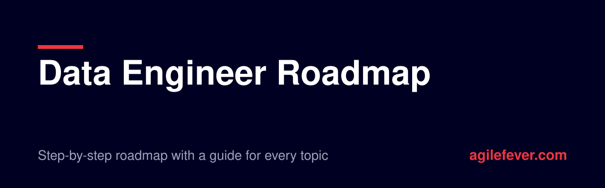

# Data Engineer Roadmap

> A step-by-step roadmap to become a Data Engineer, from Python and SQL to Spark, Airflow, Kafka, Databricks, Snowflake and cloud, with a blog for every topic

## Table of Contents

- [Who is a Data Engineer?](#who-is-a-data-engineer)
- [How to Use This Roadmap](#how-to-use-this-roadmap)
- [Step 0: Must Know](#step-0-must-know)
- [Step 1: Python for Data Engineering](#step-1-python-for-data-engineering)
- [Step 2: SQL for Data Engineering](#step-2-sql-for-data-engineering)
- [Step 3: Git and GitHub](#step-3-git-and-github)
- [Step 4: Spark and PySpark](#step-4-spark-and-pyspark)
- [Step 5: Data Pipelines and Orchestration](#step-5-data-pipelines-and-orchestration)
- [Step 6: Data Platforms: Databricks and Snowflake](#step-6-data-platforms-databricks-and-snowflake)
- [Step 7: Apache Kafka and Streaming](#step-7-apache-kafka-and-streaming)
- [Step 8: CI/CD for Data Engineering](#step-8-cicd-for-data-engineering)
- [Step 9: Cloud Platform: Google Cloud](#step-9-cloud-platform-google-cloud)
- [Step 10: Data Architecture: Warehouse, Lake and Lakehouse](#step-10-data-architecture-warehouse-lake-and-lakehouse)
- [Step 11: Projects, Skills and Career Preparation](#step-11-projects-skills-and-career-preparation)
- [Learn This Roadmap with a Mentor](#learn-this-roadmap-with-a-mentor)
- [License](#license)

### Prepared and maintained by [AgileFever](https://agilefever.com)

### Follow AgileFever

- [LinkedIn](https://www.linkedin.com/company/agilefever/)
- [YouTube](https://www.youtube.com/@AgileFever)
- [X/Twitter](https://x.com/agilefever)
- [Website](https://agilefever.com)

## Learn with AgileFever

- [Data Engineer BootCamp](https://agilefever.com/bootcamps/data-engineer-bootcamp/)

---

> **Note: We keep updating this roadmap with new topics and blogs.**

---

### Who is a Data Engineer?

A Data Engineer builds the systems that move data from where it is created to where it is used. Analysts, data scientists and AI applications all depend on this work being correct and on time.

In simple words, this person is:

- **A pipeline builder:** writes the jobs that extract, transform and load data, and schedules them.
- **A platform user:** works with Spark, Databricks, Snowflake and Kafka to handle large and fast-moving data.
- **A reliability owner:** adds logging, retries, alerts, testing and access control so pipelines keep running.

This is why we start with Python and SQL, then learn distributed processing, orchestration, streaming and cloud, and finish with data architecture.

### How to Use This Roadmap

This roadmap is designed so that you can follow it in the given order.

- Follow the steps in order. Each step builds on the previous one.
- Inside each step, read the blogs in the given order. Each blog covers one topic in plain words.
- A topic without a link is something to practise or look up in the official documentation of the tool.
- Many topics here are tools. Open the tool's free tier or a local install and run every example yourself.
- After every step, ask yourself: "Can I explain this and use it on a small project?" If yes, move on.

Let's get started.

### Step 0: Must Know

Data Engineering sits next to analytics and data science. We start by seeing where the roles differ and what the work looks like.

- [Data Engineer vs Data Analyst vs Data Scientist](https://agilefever.com/data-engineer-vs-data-analyst-vs-data-scientist/)
- [Ultimate roadmap for AI data engineering](https://agilefever.com/artificial-intelligence-data-engineering/)
- [A complete roadmap to becoming an AI Data Engineer](https://agilefever.com/roadmap-to-become-ai-data-engineer/)
- [Data Engineer BootCamp: the complete guide](https://agilefever.com/data-engineer-bootcamp-complete-guide/)

### Step 1: Python for Data Engineering

Python is the glue of most data pipelines. In this step we write clean scripts that read, change and write files.

- [Python for AI roadmap: NumPy, Pandas and PyTorch in the right order](https://agilefever.com/python-for-ai-roadmap/)
- Variables, data types, lists, tuples, dictionaries and sets
- Functions
- File handling: CSV, JSON and text
- VS Code and Jupyter Notebook

### Step 2: SQL for Data Engineering

SQL is the most used skill in this field. We learn to write queries that are correct first and fast second.

- SELECT, WHERE, GROUP BY and ORDER BY
- INNER and LEFT joins
- Window functions: ROW_NUMBER, RANK and LAG
- Common table expressions (CTEs)
- Practising on MySQL and PostgreSQL

### Step 3: Git and GitHub

Pipelines are code, and code needs history and review. This step covers the Git habits every team expects.

- Repositories and commits
- Branching and merging
- Push, pull and clone
- Resolving conflicts

### Step 4: Spark and PySpark

When data no longer fits on one machine, we split the work across many. Spark is the standard tool for that.

- Spark architecture
- RDDs and DataFrames
- Transformations and actions
- Spark SQL
- Running PySpark on Databricks

### Step 5: Data Pipelines and Orchestration

A pipeline that runs once by hand is not a pipeline. We learn to design jobs that run on a schedule, fail safely and tell us when something breaks.

- ETL vs ELT
- Building a data pipeline
- Error handling and logging
- Retries and alerts
- Apache Airflow, Databricks Workflows and Azure Data Factory

### Step 6: Data Platforms: Databricks and Snowflake

Most companies run their data on a managed platform. We learn the two most common ones.

- Databricks notebooks and clusters
- Databricks SQL and workflows scheduling
- Snowflake warehouse basics

### Step 7: Apache Kafka and Streaming

Some data cannot wait for a nightly job. Kafka moves events in real time between systems.

- Kafka architecture: topics, partitions and brokers
- Producers and consumers
- Creating a topic and streaming messages
- Confluent Cloud and Redpanda

### Step 8: CI/CD for Data Engineering

We apply the same automation used in software teams to data jobs, so a change is tested before it reaches production.

- CI vs CD concepts
- GitHub Actions workflows
- Automated testing and linting
- Docker, MLflow and DagsHub in data projects
- Triggering a deployment or a data job

### Step 9: Cloud Platform: Google Cloud

Pipelines usually run in the cloud. We use Google Cloud to learn storage, access control and running a compute job.

- Google Cloud Storage
- IAM and access control
- Deploying a compute job securely

### Step 10: Data Architecture: Warehouse, Lake and Lakehouse

The last technical step is design. We compare the main architectures and learn when each one fits.

- Data warehouse
- Data lake
- Lakehouse architecture with Databricks
- Comparing architectures and use cases

### Step 11: Projects, Skills and Career Preparation

Employers look for a pipeline you built end to end. In this step we plan portfolio projects, check whether the path fits our background, and prepare for interviews.

- [Data engineering skills you will build](https://agilefever.com/data-engineering-skills-data-engineer-bootcamp/)
- [Data Engineer BootCamp: module-by-module curriculum](https://agilefever.com/data-engineer-bootcamp-curriculum-breakdown/)
- [Is the Data Engineer BootCamp right for backend developers?](https://agilefever.com/data-engineer-bootcamp-for-backend-developers/)
- [Data Engineer BootCamp vs MLOps BootCamp](https://agilefever.com/data-engineer-bootcamp-vs-mlops-bootcamp/)
- [What a capstone project should prove](https://agilefever.com/agilefever-capstones-what-they-prove/)
- Data engineering interview questions and answers

## Learn This Roadmap with a Mentor

If you want to learn this roadmap in a live cohort with labs, the [Data Engineer BootCamp](https://agilefever.com/bootcamps/data-engineer-bootcamp/) covers the same modules in the same order. The course page lists the tools and outcomes for each module.

## License

This roadmap is licensed under CC BY 4.0. You may share and adapt it with credit to AgileFever.
